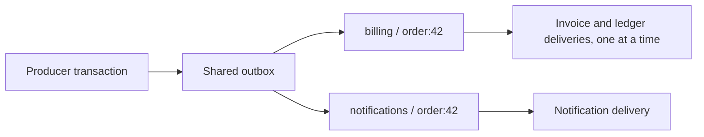

import Tabs from '@theme/Tabs';
import TabItem from '@theme/TabItem';

# Processing Groups

Processing groups are available from **1.12.0** and are **disabled by default**.
They let handlers share one outbox while choosing which handlers must process a business key
sequentially. Each matching handler still receives its own delivery record.

The ordering boundary is **(processing group, business key) within one source outbox**.
Handlers in the same group share that boundary. Different groups can process the same business
key independently, and different keys can run in parallel within a group.

Groups do not distribute an event among competing subscribers: all matching handlers receive it.
A group does not select handlers; payload matching and generic `supports()` predicates do that.

## Enable Grouped Scheduling

```yaml
namastack:
  outbox:
    processing-groups:
      enabled: true
```

This setting controls **newly scheduled records**. With the default `false`, every handler uses
the `default` group for new deliveries, even if it declares another group. The supplied business
key is stored unchanged. With `true`, each selected handler's declared group is used.

Readers always decode existing grouped records, including when this setting is `false`.
Upgrade every worker before enabling grouped scheduling; see [Rollout and Group Changes](#rollout-and-group-changes).

## Assign Groups to Handlers

### Annotated Handlers

Set `processingGroup` on `io.namastack.outbox.annotation.OutboxHandler`:

```kotlin
@Component
class OrderHandlers(
    private val invoiceService: InvoiceService,
    private val ledgerService: LedgerService,
    private val notificationService: NotificationService
) {
    @OutboxHandler(id = "orders.invoice", processingGroup = "billing")
    fun createInvoice(event: OrderCreated) {
        invoiceService.create(event.orderId)
    }

    @OutboxHandler(id = "orders.ledger", processingGroup = "billing")
    fun updateLedger(event: OrderCreated) {
        ledgerService.record(event.orderId)
    }

    @OutboxHandler(id = "orders.notify", processingGroup = "notifications")
    fun notifyCustomer(event: OrderCreated) {
        notificationService.send(event.orderId)
    }
}
```

For `outbox.schedule(OrderCreated("42"), "order:42")`, inside the producer transaction:

| Handler | Group | Business key | Shared ordering boundary |
|---|---|---|---|
| `orders.invoice` | `billing` | `order:42` | With `orders.ledger` |
| `orders.ledger` | `billing` | `order:42` | With `orders.invoice` |
| `orders.notify` | `notifications` | `order:42` | Independent of billing |



The diagram does not specify whether invoice or ledger runs first. For records created by the
same scheduling call, their IDs break the timestamp tie; method declaration order is not a
business ordering contract.

### Interface Handlers

Typed handlers override `getTypedHandlerProcessingGroup()`. Generic handlers override
`getGenericHandlerProcessingGroup()`. Both default to `OutboxProcessingGroup.DEFAULT`, whose
value is `"default"`.

<Tabs>
<TabItem value="kotlin" label="Kotlin">

```kotlin
@Component
class InvoiceHandler : OutboxTypedHandler<OrderCreated> {
    override fun getTypedHandlerIdentity() = OutboxHandlerIdentity("orders.invoice")
    override fun getTypedHandlerProcessingGroup() = "billing"

    override fun handle(payload: OrderCreated, metadata: OutboxRecordMetadata) {
        println("Invoice for ${metadata.key} in ${metadata.processingGroup}")
    }
}

@Component
class AuditHandler : io.namastack.outbox.handler.OutboxHandler {
    override fun getGenericHandlerIdentity() = OutboxHandlerIdentity("orders.audit")
    override fun getGenericHandlerProcessingGroup() = "audit"

    override fun supports(payload: Any, metadata: OutboxRecordMetadata) = payload is OrderCreated

    override fun handle(payload: Any, metadata: OutboxRecordMetadata) {
        println("Audit for ${metadata.key} in ${metadata.processingGroup}")
    }
}
```

</TabItem>
<TabItem value="java" label="Java">

```java
@Component
class InvoiceHandler implements OutboxTypedHandler<OrderCreated> {
    @Override
    public OutboxHandlerIdentity getTypedHandlerIdentity() {
        return new OutboxHandlerIdentity("orders.invoice");
    }

    @Override
    public String getTypedHandlerProcessingGroup() {
        return "billing";
    }

    @Override
    public void handle(OrderCreated payload, OutboxRecordMetadata metadata) {
        System.out.println(metadata.getKey() + " in " + metadata.getProcessingGroup());
    }
}
```

For a generic Java handler, implement `io.namastack.outbox.handler.OutboxHandler` and override
`getGenericHandlerProcessingGroup()` instead.

</TabItem>
</Tabs>

Group names must match `[a-z0-9][a-z0-9._-]{0,63}`: 1–64 lowercase ASCII characters, starting
with a letter or digit. Invalid declarations fail registration, even if grouped scheduling is
disabled. Group assignment belongs to the handler declaration; there is no configuration map
for overriding individual handlers' groups.

## Metadata and Messaging Keys

Primary handlers receive the original business key in `OutboxRecordMetadata.key` and the group
in `processingGroup`. Fallbacks receive the same values through `OutboxFailureContext.recordKey`
and `processingGroup`. The group is read from the stored record, not the current handler declaration.
It is not added to the custom `context` map.

During scheduling, a generic handler's `supports()` receives the original key and its effective
group: `default` while the opt-in is disabled, otherwise its declared group.

Kafka, RabbitMQ, and SNS routing use the business key from metadata by default. The storage
encoding does not become the Kafka key, RabbitMQ routing key, or SNS message group ID.
Routing callbacks can explicitly include the group in a header:

```kotlin
kafkaOutboxRouting {
    defaults {
        target("orders")
        header("processing-group") { _, metadata -> metadata.processingGroup }
    }
}
```

No processing-group header is added automatically. An SNS message group ID and a Namastack
processing group serve separate purposes.

## Ordering, Retries, and Resources

For each stored key, repositories load records by ascending `createdAt`, then ascending `id`.
The scheduler invokes those deliveries synchronously, one at a time. With the default
`processing.stop-on-first-failure=true`, a pending retry or permanent failure blocks subsequent
deliveries only for that group and business key. This includes deliveries to other handlers in
the same group.

A successful fallback with disposition `COMPLETE` releases that boundary. A throwing fallback
or disposition `FAIL` leaves the record failed and the boundary blocked. With
`stop-on-first-failure=false`, the scheduler can continue past failed or not-yet-due deliveries;
strict successful-completion ordering is then disabled.

This serializes available records; it does not establish business-event or transaction commit
order. Multiple handler records from one event share a timestamp. UUIDs break ties without
expressing causality. A concurrent producer can commit an earlier timestamp after another
record has already been processed. There is no ordering across different groups or keys.

Group independence does not reserve threads, database connections, or partitions. Groups use
the existing executor and database resources. A scheduler waits for every key task in its
current batch before polling again, so a slow handler can delay work outside that batch.
Different keys in the same partition can still be processed in parallel.

Group identity, retry state, and record ordering survive restarts and partition reassignment.
Delivery remains at least once: a crash after a side effect but before completion can cause
redelivery. Processing groups add no inbox or deduplication mechanism.

## Storage and Operational Queries

Groups use the existing record-key field; **no schema migration or new group-specific index is
required**. JDBC, JPA, and MongoDB keep their existing repository contracts.

| Group | Business key | Stored key |
|---|---|---|
| `default` | `order:42` | `order:42` |
| `billing` | `order:42` | `~ns.pg1~billing:order:42` |

The prefix identifies the encoding version. Group names cannot contain `:`, so the first colon
after the prefix separates the group from the unchanged business key. Business keys may contain
colons and Unicode. With grouped scheduling enabled, new business keys cannot start with the
reserved prefix `~ns.pg1~`, including for default-group deliveries.

Non-default encoded keys must fit within **255 UTF-8 bytes**, including the prefix and group.
The codec adds no new length limit to default-group keys; existing database limits still apply.
All selected keys are validated before the first delivery record is saved.

`OutboxRecord.key`, repository operations, partition hashing, and raw database queries use the
stored key. Update custom monitoring or queries that assume the column always contains the
business key. Actuator's existing deletion operation also takes the stored key; it has no
separate processing-group parameter. The codec is an internal implementation detail.

Malformed, non-canonical, and unknown-version encodings are read as unchanged default-group keys.
An old freely chosen key that exactly matches a valid encoding is indistinguishable from a grouped
key and will be decoded, even with the opt-in disabled. This collision is an accepted compatibility
limitation of reusing the column.

## Rollout and Group Changes

1. Deploy version 1.12.0 or newer to **all workers sharing the outbox**, leaving grouped scheduling disabled.
2. Verify the rollout through your deployment tooling. Namastack does not detect worker capabilities.
3. Pause affected producers and drain their old deliveries before moving a handler to a non-default
   group. Include delayed retries and resolve permanently failed records that still block a key.
4. Enable grouped scheduling consistently on producers and resume production.

The default group retains the old plain keys. Changing a handler's group affects new deliveries
only; open records retain their stored group. Old and new group assignments can therefore run
independently for the same business key. Handler aliases preserve routing IDs but do not migrate
records between groups.

Apply the same pause-and-drain procedure when changing groups later or disabling grouped writes
for handlers that previously used non-default groups. Turning the flag off does not make existing
encoded records readable by older library versions. Keep compatible workers until those records
have drained before downgrading.

The missing-payload/handler safeguards described in [Rolling Deployments](rolling-deployments.md)
do not protect against an old worker that understands the handler but treats an encoded key as a
plain business key.

The new metadata properties preserve existing getters. Adding fields to `OutboxRecordMetadata`
and `OutboxFailureContext` changes constructor and generated `copy` signatures; code that constructs
or copies these values must be recompiled and Java constructor calls must supply the new field.

## Transaction Boundaries

Processing groups do not change the transaction model. Schedule the business change and all
matching delivery records in the same producer transaction. Handler invocation continues through
the registered Spring proxy, preserving transaction and other advisors.

A handler may use `@Transactional` to commit its own business updates and a follow-up event together
when both use the same database and transaction manager. Namastack does not currently wrap that
handler transaction and completion of the original delivery in one shared processing transaction.
The original delivery can therefore be retried after the handler's transaction has committed.
