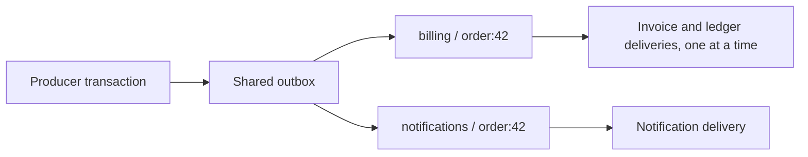

import Tabs from '@theme/Tabs';
import TabItem from '@theme/TabItem';

# Processing Groups

:::info Available since 1.12.0
Processing groups are available since version 1.12.0.
:::

Processing groups let handlers share one outbox while choosing which handlers must process a
business key sequentially. Each matching handler receives its own delivery record.

The ordering boundary is **(processing group, business key) within one source outbox**.
Handlers in the same group share that boundary. Different groups can process the same business
key independently, and different keys can run in parallel within a group.

Groups do not distribute an event among competing subscribers: all matching handlers receive it.
A group does not select handlers; payload matching and generic `supports()` predicates do that.

## Enable Grouped Scheduling

```yaml
namastack:
  outbox:
    processing-groups:
      enabled: true
```

Grouped scheduling is **disabled by default**. The setting applies when records are scheduled:

- `false`: every delivery is scheduled in the `default` group, regardless of the handler's
  declared group. The business key is stored as supplied.
- `true`: every delivery is scheduled in the declared group of its handler.

Records already stored in a group are always processed in that group, regardless of this
setting. All workers sharing the outbox must support processing groups before the setting is
enabled; see [Rollout and Group Changes](#rollout-and-group-changes).

## Assign Groups to Handlers

### Annotated Handlers

Set `processingGroup` on `io.namastack.outbox.annotation.OutboxHandler`:

```kotlin
@Component
class OrderHandlers(
    private val invoiceService: InvoiceService,
    private val ledgerService: LedgerService,
    private val notificationService: NotificationService
) {
    @OutboxHandler(id = "orders.invoice", processingGroup = "billing")
    fun createInvoice(event: OrderCreated) {
        invoiceService.create(event.orderId)
    }

    @OutboxHandler(id = "orders.ledger", processingGroup = "billing")
    fun updateLedger(event: OrderCreated) {
        ledgerService.record(event.orderId)
    }

    @OutboxHandler(id = "orders.notify", processingGroup = "notifications")
    fun notifyCustomer(event: OrderCreated) {
        notificationService.send(event.orderId)
    }
}
```

For `outbox.schedule(OrderCreated("42"), "order:42")`, inside the producer transaction:

| Handler          | Group           | Business key | Shared ordering boundary |
|------------------|-----------------|--------------|--------------------------|
| `orders.invoice` | `billing`       | `order:42`   | With `orders.ledger`     |
| `orders.ledger`  | `billing`       | `order:42`   | With `orders.invoice`    |
| `orders.notify`  | `notifications` | `order:42`   | Independent of billing   |



The diagram does not specify whether invoice or ledger runs first. For records created by the
same scheduling call, their IDs break the timestamp tie; method declaration order is not a
business ordering contract.

### Interface Handlers

Typed handlers override `getTypedHandlerProcessingGroup()`. Generic handlers override
`getGenericHandlerProcessingGroup()`. Both default to `OutboxProcessingGroup.DEFAULT`, whose
value is `"default"`.

<Tabs>
<TabItem value="kotlin" label="Kotlin">

```kotlin
@Component
class InvoiceHandler : OutboxTypedHandler<OrderCreated> {
    override fun getTypedHandlerIdentity() = OutboxHandlerIdentity("orders.invoice")
    override fun getTypedHandlerProcessingGroup() = "billing"

    override fun handle(payload: OrderCreated, metadata: OutboxRecordMetadata) {
        println("Invoice for ${metadata.key} in ${metadata.processingGroup}")
    }
}

@Component
class AuditHandler : io.namastack.outbox.handler.OutboxHandler {
    override fun getGenericHandlerIdentity() = OutboxHandlerIdentity("orders.audit")
    override fun getGenericHandlerProcessingGroup() = "audit"

    override fun supports(payload: Any, metadata: OutboxRecordMetadata) = payload is OrderCreated

    override fun handle(payload: Any, metadata: OutboxRecordMetadata) {
        println("Audit for ${metadata.key} in ${metadata.processingGroup}")
    }
}
```

</TabItem>
<TabItem value="java" label="Java">

```java
@Component
class InvoiceHandler implements OutboxTypedHandler<OrderCreated> {
    @Override
    public OutboxHandlerIdentity getTypedHandlerIdentity() {
        return new OutboxHandlerIdentity("orders.invoice");
    }

    @Override
    public String getTypedHandlerProcessingGroup() {
        return "billing";
    }

    @Override
    public void handle(OrderCreated payload, OutboxRecordMetadata metadata) {
        System.out.println(metadata.getKey() + " in " + metadata.getProcessingGroup());
    }
}
```

For a generic Java handler, implement `io.namastack.outbox.handler.OutboxHandler` and override
`getGenericHandlerProcessingGroup()` instead.

</TabItem>
</Tabs>

Group names must match `[a-z0-9][a-z0-9._-]{0,63}`: 1–64 lowercase ASCII characters, starting
with a letter or digit. Invalid declarations fail registration, even if grouped scheduling is
disabled. Group assignment belongs to the handler declaration; there is no configuration map
for overriding individual handlers' groups.

## Metadata and Messaging Keys

Primary handlers receive the business key in `OutboxRecordMetadata.key` and the group in
`OutboxRecordMetadata.processingGroup`. Fallbacks receive the same values through
`OutboxFailureContext.recordKey` and `OutboxFailureContext.processingGroup`. The group is read
from the stored record, not from the current handler declaration. It is not part of the custom
`context` map.

During scheduling, a generic handler's `supports()` receives the business key and the group the
delivery would be scheduled in: `default` when grouped scheduling is disabled, otherwise the
handler's declared group.

Kafka, RabbitMQ, and SNS routing use the business key from metadata as the Kafka key, RabbitMQ
routing key, and SNS message group ID. Routing callbacks can include the group in a header:

```kotlin
kafkaOutboxRouting {
    defaults {
        target("orders")
        header("processing-group") { _, metadata -> metadata.processingGroup }
    }
}
```

The processing group is not added to messages unless a routing callback adds it. An SNS message
group ID and a processing group are unrelated concepts.

## Ordering, Retries, and Resources

For each stored key, repositories load records by ascending `createdAt`, then ascending `id`.
The scheduler invokes those deliveries synchronously, one at a time. With the default
`processing.stop-on-first-failure=true`, a pending retry or permanent failure blocks subsequent
deliveries only for that group and business key. This includes deliveries to other handlers in
the same group.

A successful fallback with disposition `COMPLETE` releases that boundary. A throwing fallback
or disposition `FAIL` leaves the record failed and the boundary blocked. With
`stop-on-first-failure=false`, the scheduler moves past failed or not-yet-due deliveries, so
later deliveries can complete before earlier ones.

Ordering serializes the available records; it does not reflect business-event or transaction
commit order. Handler records created by one scheduling call share a timestamp, and their IDs
break the tie without expressing causality. A concurrent producer can commit an earlier
timestamp after another record has already been processed. Different groups and different keys
have no ordering relationship.

Groups share the scheduler's executor, database connections, and partitions; no resources are
reserved per group. A scheduler waits for every key task in its current batch before polling
again, so a slow handler can delay work outside that batch. Different keys in the same
partition are processed in parallel.

Group identity, retry state, and record ordering survive restarts and partition reassignment.
Delivery is at least once: a crash after a side effect but before completion can cause
redelivery. Processing groups provide no inbox or deduplication mechanism.

## Storage and Operational Queries

The group is stored as part of the record key; there is no separate group column or index.
This works the same way for JDBC, JPA, and MongoDB.

| Group     | Business key | Stored key                 |
|-----------|--------------|----------------------------|
| `default` | `order:42`   | `order:42`                 |
| `billing` | `order:42`   | `~ns.pg1~billing:order:42` |

The prefix identifies the encoding version. Group names cannot contain `:`, so the first colon
after the prefix separates the group from the business key. Business keys may contain colons
and Unicode. With grouped scheduling enabled, business keys must not start with the reserved
prefix `~ns.pg1~`, including for default-group deliveries.

Keys of non-default groups must fit within **255 UTF-8 bytes**, including the prefix and group.
Default-group keys are stored unchanged and are limited only by the database column. All keys of
one scheduling call are validated before the first delivery record is saved.

`OutboxRecord.key`, repository operations, partition hashing, raw database queries, and the
actuator deletion operation use the stored key. `OutboxRecord.businessKey` and
`OutboxRecord.processingGroup` expose the decoded values. Handler metadata, fallback contexts,
and processing observations use the decoded values: the `outbox.record.key` attribute contains
the business key and `outbox.processing.group` the group. The scheduling observation records the
explicit key or `auto-generated` and covers all deliveries of the call, which can span several
groups. Compatibility exceptions report `businessKey`, `processingGroup`, and `storageKey`.

Malformed, non-canonical, and unknown-version encodings are read as plain keys in the default
group. A key that exactly matches a valid encoding is always decoded as a grouped key, even when
grouped scheduling is disabled.

The design and its tradeoffs are recorded in
[ADR-0004](https://github.com/namastack/namastack-outbox/blob/main/docs/adr/0004-processing-groups-without-schema-migration.md).

## Rollout and Group Changes

1. Deploy version 1.12.0 or newer to **all workers sharing the outbox**, leaving grouped scheduling disabled.
2. Verify the rollout through your deployment tooling. Namastack does not detect worker capabilities.
3. Pause affected producers and drain their pending deliveries before moving a handler to a
   non-default group. Include delayed retries and resolve permanently failed records that block a key.
4. Enable grouped scheduling consistently on producers and resume production.

A handler's group applies to deliveries scheduled from then on; stored records keep the group
they were scheduled in. If a handler's group changes while records are pending, records in the
previous and the new group can be processed independently for the same business key. Handler
aliases map handler IDs, not groups, and do not move records between groups.

Apply the same pause-and-drain procedure when changing a handler's group or disabling grouped
scheduling. Library versions before 1.12.0 cannot read grouped records, whatever the setting;
keep workers on 1.12.0 or newer until all grouped records have drained.

The missing-payload and missing-handler safeguards described in
[Rolling Deployments](rolling-deployments.md) do not apply here: a worker before 1.12.0 finds the
handler and passes the stored key to it as the business key.

## Transaction Boundaries

The business change and all matching delivery records are written in the same producer
transaction. Handlers are invoked through their Spring proxy, so `@Transactional` and other
advisors apply.

A handler may use `@Transactional` to commit its own business updates and a follow-up event
together when both use the same database and transaction manager. Completion of the delivery is
committed separately from that handler transaction, so the delivery can be retried after the
handler's transaction has committed.
