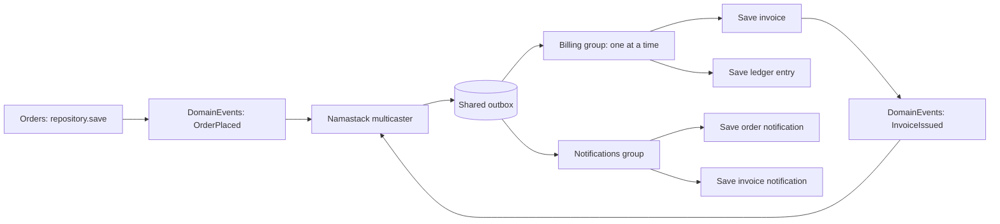

# Spring Modulith Internal Event Delivery

This example uses Namastack for all business-event delivery between three Spring Modulith modules.
It runs in one JVM with one H2 database, one transaction manager, and one shared JDBC outbox.
No broker is required.

Spring Modulith provides the module model, architecture verification, and isolated module tests.
The aggregates extend Spring Data's `AbstractAggregateRoot` and register domain events with
`registerEvent()`. Spring Data JDBC repositories publish those events when saving. Namastack's
multicaster routes events marked with `@OutboxEvent` into the outbox; consumers use `@OutboxHandler`.
[idempotency4j](https://github.com/josipmusa/idempotency4j/tree/v0.5.0) protects the handlers against
repeated delivery using a JDBC idempotency table in that same database.

## Versions and Prerequisites

- Java 21
- Spring Modulith **2.2.0-RC1** and Spring Boot **4.2.0-RC1** (prereleases)
- idempotency4j **0.5.0**, with its Spring Boot starter and JDBC store
- The current Namastack feature snapshot containing Processing Groups, planned for **1.12.0**

The shared example catalog currently calls this snapshot `1.11.0-SNAPSHOT`. A released 1.11.0
artifact does not contain Processing Groups. Build and publish this checkout locally first:

```bash
# From the repository root
./gradlew publishToMavenLocal -x test

cd namastack-outbox-examples/namastack-outbox-example-modulith-delivery
./gradlew test
./gradlew bootRun
```

Each application start places an order. The worker creates an invoice, a ledger entry, an order
notification, and an invoice notification. Log messages include the order ID so you can follow
delivery across modules. The application keeps running to process the outbox; stop it with Ctrl+C.

H2 stores data in `./data/modulith-delivery`. Business data, outbox records, and idempotency records survive application
restarts. Completed delivery records are retained for inspection. Notifications are database rows
representing simulated notifications; this example does not send email.

## Event Flow



The module dependencies form a directed graph:

- `orders` exposes `OrderService` and `OrderPlaced` and has no application-module dependencies.
- `billing` depends on the public Orders API and exposes `InvoiceIssued`.
- `notifications` depends on the public events of Orders and Billing.

Aggregates, handlers, and repository interfaces live in each module's `internal` package. Services
and handlers coordinate business actions; Spring Data generates the persistence implementation
and publishes the aggregates' events in the caller's transaction. Modules do not call another
module's handlers or access its tables. The integration test inspects all tables to verify the
result; that is test code, not a production module dependency.

## Spring Data Domain Events

`CustomerOrder` and `Invoice` extend `AbstractAggregateRoot` rather than maintaining their own
event lists and publication callbacks. `CustomerOrder.place()` registers an `OrderPlaced` event
with `registerEvent()`.
The service only creates and saves the aggregate:

```kotlin
@Transactional(rollbackFor = [Exception::class])
fun placeOrder(description: String, amountCents: Long): UUID {
    val order = CustomerOrder.place(description, amountCents)
    return orders.save(order).id
}
```

`AbstractAggregateRoot` provides the `@DomainEvents` and `@AfterDomainEventPublication` methods.
During `save()`, Spring Data uses them to publish the registered events through Spring's event
infrastructure and then clear the list. Loading an aggregate does not generate a new event,
and saving it again does not republish the cleared events.

Both public event classes carry the same key expression:

```kotlin
@OutboxEvent(key = "'order:' + #root.orderId")
data class OrderPlaced(val orderId: UUID, val description: String, val amountCents: Long)
```

Namastack's multicaster synchronously schedules the matching deliveries before the enclosing
transaction commits. `@DomainEvents` itself is an in-memory publication mechanism; the outbox
provides durability. Keep `@Transactional` on the service and handlers so aggregate persistence
and event publication are enclosed by the same transaction. Repositories alone are not the
transaction boundary this example relies on.

`Invoice.issue()` follows the same pattern for `InvoiceIssued`. Neither the service nor the
handlers call `Outbox.schedule()` or `ApplicationEventPublisher` directly.

The aggregates use nullable `@Version` properties so Spring Data recognizes a freshly created
aggregate with an assigned UUID as new. These properties also enable optimistic locking; they
do not provide deduplication of handler deliveries. Recreate aggregate instances when retrying
a rolled-back business operation rather than reusing their already-cleared in-memory event lists.

## Processing Groups

```yaml
namastack:
  outbox:
    multicaster:
      enabled: true
      publish-after-save: false
    processing-groups:
      enabled: true
    processing:
      stop-on-first-failure: true
```

Every matching handler receives a separate durable delivery record:

| Event | Handler ID | Processing group |
|---|---|---|
| `OrderPlaced` | `billing.issue-invoice` | `billing` |
| `OrderPlaced` | `billing.record-ledger` | `billing` |
| `OrderPlaced` | `notifications.order-received` | `notifications` |
| `InvoiceIssued` | `notifications.invoice-issued` | `notifications` |

All events for an order use the business key `order:<orderId>`, derived from their `@OutboxEvent`
annotations. All handlers receive `OutboxRecordMetadata` for the persisted delivery ID; the invoice
handler also uses its original key and group for logging. `publish-after-save=false` prevents the annotated events from
also being delivered to Spring listeners. Ordinary unannotated Spring events still work normally.

The two Billing handlers share a serialization boundary for that key. Neither has priority over
the other: both deliveries have the same creation timestamp, and their record IDs break the tie.
They must not rely on invoice-before-ledger execution. Notifications has an independent boundary
and can make progress while Billing is waiting for a retry. Different keys can also run in parallel.
Groups share the worker pool and database capacity.

For non-default groups, stored keys look like `~ns.pg1~billing:order:<orderId>`.
Handlers receive the business key and processing group separately. There is no group column or
additional database schema for Processing Groups.

## Transaction Boundaries and Delivery Guarantees

1. `OrderService.placeOrder()` starts a Spring transaction. Saving the order publishes its domain
   event, and the multicaster schedules all three matching `OrderPlaced` deliveries. The order
   and deliveries commit or roll back together.
2. After that commit, Namastack invokes each handler synchronously on a worker through its Spring
   proxy. The handler's `@Transactional` advisor starts a new business transaction on the shared
   transaction manager. There is no additional `@Async` layer.
3. Inside that transaction, idempotency4j checks the delivery ID in the handler's scope. An already
   completed delivery skips the handler body. Otherwise, `InvoiceHandler.issueInvoice()` saves the
   invoice. Spring Data publishes `InvoiceIssued`, and the multicaster schedules its delivery in
   the same transaction. The invoice, follow-up delivery, and completed idempotency record commit
   or roll back together.
4. After the handler returns successfully, Namastack completes its original delivery separately.
   Notifications processes the follow-up delivery asynchronously after it becomes visible.

The handler's business changes and completion of the original outbox delivery are **not one atomic
transaction**. A crash after the handler transaction commits but before completion is persisted
can still cause redelivery. While its idempotency record is retained, the repeated call skips the
business action, and Namastack can complete the original delivery without another invoice,
notification, or follow-up event. Delivery remains at least once; the modules are eventually consistent.

Services and handlers use `@Transactional(rollbackFor = [Exception::class])`, so both runtime and
checked exceptions cause rollback and reach Namastack for retry. Retry state is then stored in
a separate transaction after the handler transaction has ended.
With strict ordering, an outstanding retry or permanent failure blocks the affected group/key.
Ordering does not establish producer commit order across concurrent transactions.

If storing completion fails, the worker propagates the persistence error and reloads the database
state on a later polling cycle. It does not consume a handler retry or invoke a fallback for that
storage failure. A pending delivery can be redelivered; an already committed completion stays
completed even if its acknowledgement was lost.

## Idempotent Handler Execution

Each handler combines its existing transaction with idempotency4j:

```kotlin
@Transactional(rollbackFor = [Exception::class])
@Idempotent(
    key = "#metadata.recordId",
    scope = "billing.issue-invoice",
    completion = "join-transaction",
    waitTimeout = "PT0S",
)
@OutboxHandler(id = "billing.issue-invoice", processingGroup = "billing")
fun issueInvoice(event: OrderPlaced, metadata: OutboxRecordMetadata) {
    invoices.save(Invoice.issue(event.orderId, event.amountCents))
}
```

The scope is an explicit, stable name matching that handler's ID. The idempotency key is the
persisted **delivery ID**, not `metadata.key` (which identifies the order for serialization).
Different deliveries for the same order must still execute. Each of the four handlers has its own
scope, including the two handlers sharing the Billing processing group. Keep scopes stable across
refactorings so retained records continue to protect redelivery.

Namastack invokes the registered Spring proxy. idempotency4j appends its advisor inside the existing
transaction advice, so `join-transaction` can use the same JDBC connection as the business writes
and follow-up outbox scheduling. An autonomous idempotency completion would leave another gap
between the business commit and the idempotency write; the explicit joined mode avoids that gap.
Acquiring and extending a lease use separate short transactions, allowing other workers to see
an attempt in progress. A rollback releases that lease; a worker that dies leaves a lease that
can be taken over after expiry. The default lease is 30 seconds, extended by the library while
the action runs.

`waitTimeout = "PT0S"` avoids deliberately parking a Namastack worker waiting for another attempt.
An active lease raises `IdempotencyInFlightException`; Namastack applies its normal retry policy.
It does not acknowledge the delivery as successful. JDBC lock waits and connection timeouts still
apply. Joined-completion failures propagate and roll back business changes and follow-up events.

The example explicitly selects the JDBC store and retains completed idempotency records for
**seven days** (`idempotency.default-ttl=P7D`). Schema initialization is explicitly set to `always`
for this H2 demo: the library's `embedded` mode does not initialize file-backed H2.
`@EnableScheduling` enables the library's default hourly cleanup of expired entries.
For production PostgreSQL or MySQL, migrate the provider's supplied schema before startup and set
`initialize-schema=never`; this example uses H2.
There is no additional datasource or transaction manager.

The pool has 20 connections for at most eight concurrent Namastack workers, leaving room for the
second connection each active handler briefly needs, producer transactions, and coordination.
The concurrency limit also applies if virtual threads are enabled. Revisit these settings when
adding other database users or changing worker concurrency.

### Scope of the Guarantee

- Protection ends when the completed idempotency record expires, even before cleanup deletes it.
  Set retention beyond the longest supported outage, retry, and manual-redelivery window. Seven
  days is a demo choice, not a guarantee for an indefinitely pending outbox record.
- Publishing the same logical event again creates new delivery IDs. This integration deduplicates
  retries of a delivery; it does not deduplicate independent producer publications.
- Existing completed business work from before this integration has no idempotency record. Adding
  the annotation does not retroactively protect old unacknowledged deliveries.
- Notifications here are database inserts. HTTP calls, email, and other external effects cannot
  roll back with this database transaction and require their own idempotency boundary.

## Which Spring Modulith Components Are Used?

- `spring-modulith-starter-core`: module declarations and architecture support.
- `spring-modulith-starter-test`: `ApplicationModules.verify()` and `@ApplicationModuleTest`.
- `spring-boot-starter-data-jdbc`: aggregate persistence and domain-event publication.
- `namastack-outbox-starter-jdbc`: durable scheduling, handler dispatch, retries, and partitioning.
- `idempotency-spring-boot-starter` and `idempotency-jdbc`: handler interception, durable leases,
  and idempotency completion in the handler transaction.

Spring Data uses Spring's event publication infrastructure, with Namastack's multicaster replacing
the delivery path for annotated events. There are no application `@ApplicationModuleListener`
methods, broker externalizers, or Modulith event-publication persistence starters. This example does not use
`spring-modulith-starter-namastack`, which serves Modulith's event externalization integration.
Only Namastack delivers these business events, avoiding duplicate delivery through a second
listener mechanism.

For Modulith externalization to Kafka instead, see the separate
[Spring Modulith Kafka example](../namastack-outbox-example-modulith).

## Tests

- `ModuleArchitectureTest` verifies module boundaries and declared dependencies.
- `OrderModuleTest` boots only the Orders module and verifies its public event and business key
  through the real multicaster and a mocked Outbox. It also verifies that repeated saves do not
  republish events cleared by `@AfterDomainEventPublication`.
- `DeliveryIntegrationTest` uses the real database, repositories, worker, and Spring handler proxies
  to verify all four deliveries, the follow-up event, transactional scheduling, producer rollback,
  and suppression of duplicate delivery to Spring listeners.
- `DeliveryTransactionFailureTest` runs the production processor chain on a dedicated worker thread
  and inspects the database between attempts. It covers:
  - Runtime and checked handler failures after the invoice and follow-up have been saved.
  - Producer and handler commit failures with database rollback.
  - Failure to commit retry state, leaving the original delivery pending.
  - Failure to commit completion, preserving the handler's committed data and allowing redelivery.
  - Lost handler commit acknowledgement, preserving the committed idempotency record on retry.
  - Lost completion acknowledgement, preserving the committed completion without consuming a retry.
- `DeliveryIdempotencyTest` verifies repeated delivery for all four handlers, separate deliveries
  sharing a business key, retry while a lease is active, recovery of an abandoned lease, and rollback
  of business writes and follow-up events when the idempotency completion update fails.
- `DeliveryIdempotencyRestartTest` closes the application after a handler commit without outbox
  acknowledgement, then starts a new application context against the same temporary file database.
  The real worker resumes all deliveries without duplicating the invoice or its follow-up event.

The fault tests use real H2 transactions and a test-only transaction manager that injects errors
before or after JDBC commit. Background polling is stopped only in those tests to make individual
attempts deterministic; the normal integration tests exercise scheduled processing. This checks
the stated transaction outcomes and redelivery protection rather than simulating
every possible network failure or database outage. Core processor tests additionally cover failed
completion saves/deletes and restoration of the fallback record's in-memory state.

Tests use in-memory databases or a temporary file database and do not modify the persistent demo database.
